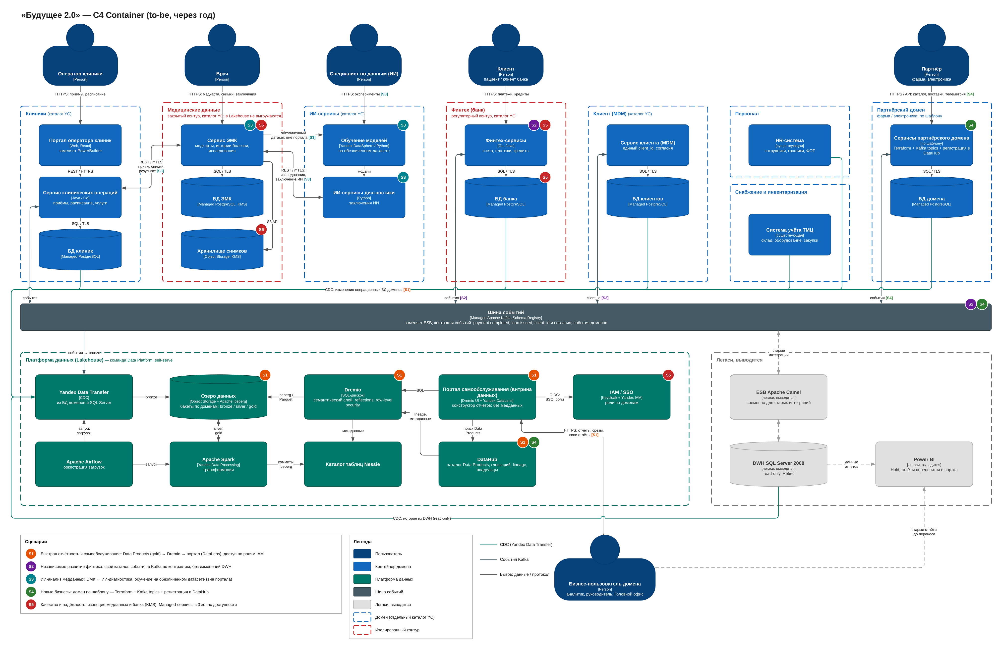

# Задание 1. Целевая архитектура и приоритизация проблем

## 1. Целевая архитектура через год (C4 Container)

[c4-container-to-be.drawio](./c4-container-to-be.drawio)

Как архитектура поддерживает ключевые бизнес-сценарии (метки на диаграмме):

| Сценарий | За счёт чего |
|---|---|
| **S1** Быстрая отчётность и самообслуживание | Data Products доменов в Lakehouse (Object Storage + Apache Iceberg + Nessie). Портал самообслуживания на Dremio: семантический слой, reflections, row-level security. Конструктор отчётов — DataLens. Тяжёлые трансформации идут в Spark по расписанию Airflow, а не в момент построения отчёта |
| **S2** Независимое развитие финтеха | Отдельная облачная среда банка; события по контрактам в Kafka; свои Data Products — DWH не меняется |
| **S3** Независимое развитие ИИ | ИИ-сервисы обучаются на обезличенном датасете домена медданных по контракту; заключения возвращаются в ЭМК |
| **S4** Подключение новых бизнесов | Шаблон домена: Terraform-среда, топики Kafka, регистрация Data Products в DataHub. Бизнес-логика в общий DWH не добавляется |
| **S5** Качество и надёжность медицинских и финансовых сервисов | Медданные и банк — в изолированных средах (KMS, отдельные IAM-роли). Managed-сервисы в 3 зонах, резервное копирование. Медданные в портал не попадают |

## 2. Проблемные места

| № | Проблема | Какие сценарии страдают | Последствие для бизнеса |
|---|---|---|---|
| P1 | Бизнес-логика финтеха, ИИ и клиник реализована в DWH (хранимые процедуры SQL Server) | S2, S3, S4 | Каждое новое направление требует доработки DWH центральной командой; запуск продуктов задерживается на месяцы |
| P2 | Сложные отчёты строятся часами: сотни ТБ, множество трансформаций в одном хранилище | S1 | Управленческие решения принимаются с задержкой, отчёты устаревают к моменту готовности |
| P3 | SQL Server 2008 без поддержки и обновлений безопасности, on-prem железо без эластичности | S1, S5 | Риск инцидента ИБ и претензий регуляторов, нельзя масштабироваться под рост данных |
| P4 | Медицинские, банковские и кадровые данные в одном хранилище с общими доступами | S5, S3 | Нарушение разделения врачебной и банковской тайны, риск для лицензии банка и штрафов |
| P5 | Нет самообслуживания: каждый новый отчёт — заявка в центральную команду BI | S1 | Очередь заявок, бизнес-пользователи ждут неделями |
| P6 | Power BI с большим количеством кастомизаций: логика показателей размазана по отчётам | S1 | Расхождения KPI между направлениями, нет единой картины |
| P7 | ESB на Apache Camel: интеграции точка-точка через центральную шину без контрактов данных | S2, S4 | Подключение нового сервиса или партнёра требует доработки шины, изменения ломают потребителей |
| P8 | Интерфейс операторов клиник на PowerBuilder | S5 | Нет веб-доступа и развития UI, мало разработчиков — страдает скорость обслуживания пациентов |
| P9 | Нет каталога данных, владельцев и lineage | S1, S4 | Данные трудно найти и проверить их качество, дублирование расчётов |
| P10 | ИИ-сервисы получают медданные через ESB и DWH без обезличивания и контрактов | S3, S5 | Риск утечки медданных, долгая подготовка датасетов для моделей |
| P11 | Нет отказоустойчивости и геораспределения | S5 | Простой медицинских и финансовых сервисов при сбое площадки |

## 3. Приоритизация

Методы: MoSCoW (горизонт — год) и матрица Эйзенхауэра (важность — влияние на цели бизнеса, срочность — риск или потери уже сейчас).

| № | Цель бизнеса | Эйзенхауэр | MoSCoW | Обоснование |
|---|---|---|---|---|
| P4 | Качество медицинских и финансовых сервисов, регуляторы | Важно и срочно | **Must** | Регуляторный риск для банковской лицензии и медицинской деятельности |
| P3 | Надёжность, затраты на поддержку | Важно и срочно | **Must** | Неподдерживаемая СУБД и железо — переезд в облако запланирован |
| P1 | Скорость выхода на рынок, выручка новых направлений | Важно и срочно | **Must** | Блокирует независимое развитие финтеха и ИИ и подключение партнёров |
| P2 | Скорость управленческих решений | Важно и срочно | **Must** | Прямая цель — портал самообслуживания с быстрыми отчётами |
| P5 | Скорость решений, нагрузка на центральную команду | Важно, не срочно | **Must** | Портал самообслуживания — финальное состояние через год |
| P10 | Качество медицинских сервисов, ИИ | Важно, не срочно | **Should** | Риск утечки снижается изоляцией (P4); контракт датасета — следующий шаг |
| P7 | Скорость выхода на рынок | Важно, не срочно | **Should** | Нужна для S2 и S4; до перехода на Kafka ESB работает |
| P9 | Качество данных, скорость решений | Важно, не срочно | **Should** | Без каталога Data Mesh не масштабируется, но запускается позже платформы |
| P11 | Надёжность сервисов | Важно, не срочно | **Should** | Закрывается managed-сервисами в 3 зонах при переезде |
| P6 | Единая картина KPI | Не важно, срочно | **Could** | Отчёты переносятся в портал постепенно, Power BI временно сохраняется |
| P8 | Скорость обслуживания пациентов | Не важно, не срочно | **Could** | Через год допустимо сохранить легаси в домене клиник; замена — после портала |

**Won't** (в этом году): перенос медицинских карт, историй болезни и исследований в аналитику и портал — по условию эти данные для аналитики не используются.
