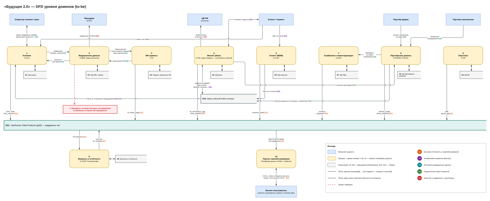

# Задание 2. Домены и потоки данных

## 1. Домены

Домены выделены по бизнес-направлениям и регуляторным контурам: у каждого свой владелец данных, своя облачная среда и свои Data Products. Новая логика реализуется внутри домена, а не в DWH.

| Домен | Владеет данными | Какой сценарий поддерживает | Data Products для портала |
|---|---|---|---|
| 1. Клиники | Приёмы, расписание, услуги, загрузка клиник | Работа клиник, отчётность по загрузке и выручке | `clinic_visits`, `clinic_services` |
| 2. Медицинские данные (закрытый) | Медкарты, истории болезни, исследования, снимки | Лечение пациентов, ИИ-диагностика | — (в портал не попадают); `med_research_dataset` — обезличенный, только для домена ИИ |
| 3. ИИ-сервисы | Модели, результаты ИИ-диагностики | Развитие ИИ-направления | `ai_model_usage` (агрегаты использования) |
| 4. Финтех (банк) | Счета, платежи, кредиты, финансовая история клиентов | Развитие финтех-направления, запуск новых финтех-сервисов | `fin_transactions_agg`, `loans_portfolio` |
| 5. Клиент (MDM) | Единый `client_id`, согласия | Единый клиент для клиник, банка и партнёров | `customer_profile` (без медданных) |
| 6. Персонал | Сотрудники, графики, ФОТ | Кадровая отчётность | `staff`, `payroll_agg` |
| 7. Снабжение и инвентаризация | Склад, оборудование, закупки | Обеспечение клиник, поставки партнёров | `inventory`, `equipment` |
| 8. Финансы и отчётность (Головной офис) | Бухучёт, финотчётность, консолидированные KPI | Целостная картина по ключевым показателям | `corp_kpi`, `fin_reporting` |
| 9. Партнёрские домены: фармацевтика, электроника | Препараты и поставки; оборудование и телеметрия | Интеграция новых компаний экосистемы | `pharma_supply`, `device_telemetry` |

**Платформа данных** — не домен, а общая self-serve инфраструктура команды Data Platform. В неё входят:
- Lakehouse: Object Storage + Apache Iceberg + Nessie;
- Airflow, Spark, Yandex Data Transfer;
- Dremio — портал самообслуживания;
- DataHub — каталог;
- шаблоны Terraform для сред доменов.

**Federated governance.** Совет по данным из представителей доменов, ИБ и юристов утверждает единые правила:
- стандарты Data Products (схема, SLA, владелец, классификация);
- контракты событий;
- модель доступа.

## 2. Потоки данных между доменами (DFD)

[dfd-domains.drawio](./dfd-domains.drawio)

| Сценарий | Как обеспечен потоками |
|---|---|
| Интеграция нового финтех-сервиса | Сервис в домене Финтех берёт `client_id` из MDM и публикует события `payment.completed` и `loan.issued` в Kafka по контракту. Платформа строит из них `fin_transactions_agg`, и данные появляются в портале. DWH не меняется |
| ИИ-анализ медицинских данных | Клиники передают данные приёма и снимки в домен медданных. Медданные отдают домену ИИ обезличенный `med_research_dataset` по контракту. ИИ возвращает заключение в ЭМК, врач видит его в клинике. В портал медданные не попадают |
| Отчётность и самообслуживание | Домены публикуют Data Products в Lakehouse (слой gold). Бизнес-пользователь строит отчёты в Dremio и DataLens в пределах своих ролей; Финансы и отчётность собирают консолидированные KPI |
| Подключение партнёров | Фармацевтика передаёт каталог препаратов и поставки в Снабжение, электроника — телеметрию оборудования в Снабжение и Клиники. Партнёрский домен получает свою среду и топики по шаблону |
| Регуляторы | Финтех отчитывается в ЦБ, медданные передаются в ЕГИСЗ — из своих доменов, без общего DWH |

## 3. Почему такое разделение выгодно бизнесу

- **Быстрее вывод продуктов.**
  - Финтех и ИИ развиваются своими командами в своих средах.
  - Новый сервис публикует события и Data Products по стандарту, без очереди на доработку DWH.
  - Новый партнёр подключается по шаблону за недели, а не за месяцы.
- **Меньше зависимость от DWH.**
  - Бизнес-логика возвращается в домены.
  - Центральное хранилище перестаёт быть узким местом и выводится из эксплуатации поэтапно: CDC → Data Products → read-only → отключение.
- **Отдельное развитие направлений.**
  - Домены масштабируют свои ресурсы независимо.
  - Сбой или релиз в одном домене не останавливает остальные.
- **Соответствие регуляторам.**
  - Медицинские и банковские данные изолированы по владельцу, среде и доступам.
  - В аналитику попадают только разрешённые Data Products.
- **Целостная картина сохраняется:** общий `client_id` (MDM), единые стандарты Data Products и консолидированные KPI в домене Финансы и отчётность.
