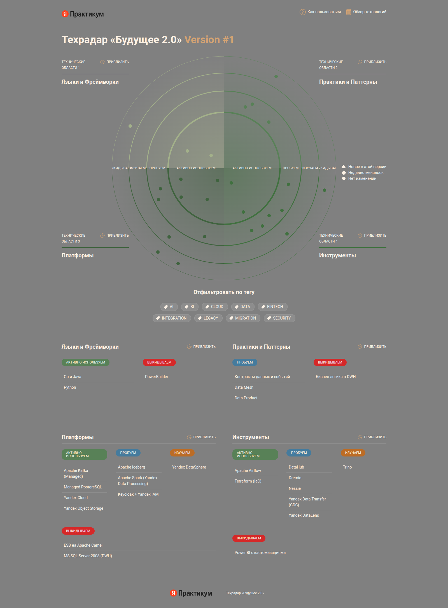
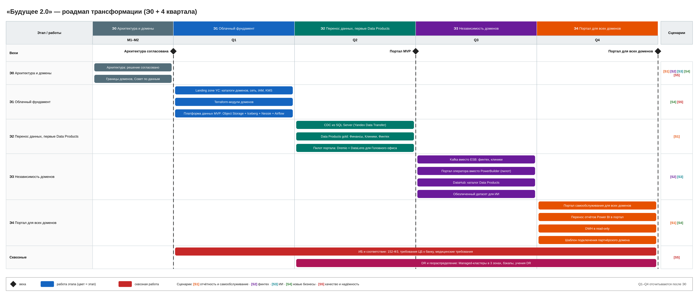

# Задание 3. Технический радар и роадмап

Сценарии:
- **S1** — быстрая отчётность и самообслуживание;
- **S2** — независимый финтех;
- **S3** — независимый ИИ;
- **S4** — подключение новых бизнесов;
- **S5** — качество и надёжность медицинских и финансовых сервисов.

## 1. Технический радар

Исходники — в формате шаблона курса (AOE Technology Radar): [techradar/](./techradar). Каждая технология описана в файле `radar/2026-11-08/<name>.md`: кольцо, квадрант, описание, сценарии.

Сборка: `cd techradar && npm install && npm run build`.

| Кольцо | Технологии | Сценарии |
|---|---|---|
| Активно используем | Python; Go и Java; Managed PostgreSQL; Yandex Object Storage; Apache Kafka; Apache Airflow; Terraform; Yandex Cloud | S1–S5 |
| Пробуем | Data Mesh; Data Product; контракты данных и событий; Apache Iceberg; Nessie; Dremio; Yandex DataLens; DataHub; Yandex Data Transfer (CDC); Apache Spark; Keycloak + Yandex IAM | S1, S2, S3, S4 |
| Изучаем | Trino (альтернатива Dremio); Yandex DataSphere (обучение моделей) | S1, S3 |
| Выводим | MS SQL Server 2008 (DWH); PowerBuilder; ESB на Apache Camel; Power BI с кастомизациями; бизнес-логика в DWH | — |

Сценарии каждой технологии указаны в её описании.

## 2. Роадмап

[roadmap.drawio](./roadmap.drawio)

| Этап | Срок | Работы | Ожидаемый результат | Команды | Ресурсы |
|---|---|---|---|---|---|
| Э0. Архитектура и домены | М1–М2 | Целевая архитектура, границы доменов, Совет по данным, план проектов витрины по доменам | Решение согласовано, домены и владельцы назначены (промежуточное состояние) | Архитекторы, лиды доменов | 2 архитектора, 0,3 ставки лидов 8 доменов |
| Э1. Облачный фундамент | Q1 | Landing zone в Yandex Cloud: каталоги доменов, сеть, IAM, KMS; Terraform-модули; платформа данных MVP (Object Storage + Iceberg + Nessie + Airflow) | Среды доменов создаются по шаблону, озеро готово к загрузке | Платформенная команда, ИБ | 4 инженера платформы, 1 ИБ |
| Э2. Перенос данных и первые Data Products | Q2 | CDC из SQL Server (Yandex Data Transfer); Data Products Финансов, Клиник, Финтеха; пилот портала на Dremio + DataLens для Головного офиса | Ключевые отчёты строятся за минуты, пилот портала работает | Платформа, команды доменов Финансы, Клиники, Финтех | +3 дата-инженера, облако под сотни ТБ |
| Э3. Независимость доменов | Q3 | Kafka вместо ESB для финтеха и клиник; DataHub; обезличенный датасет для ИИ; пилот веб-портала оператора вместо PowerBuilder | Новые финтех-сервисы и ИИ-модели запускаются без DWH | Команды Финтех, ИИ, Клиники, Медданные | 2 команды по 5 человек, Managed Kafka |
| Э4. Портал для всех доменов | Q4 | Портал для всех доменов с RLS; перенос отчётов Power BI; DWH в режиме read-only; шаблон подключения партнёрского домена | Финальное состояние: бизнес-пользователи работают с данными сами, партнёр подключается по шаблону | Платформа, все домены | Лицензии и обучение пользователей |
| Сквозное: ИБ и соответствие | Q1–Q4 | Изоляция медданных и банка, KMS, аудит, требования 152-ФЗ, ЦБ и Минздрава | Аудиты пройдены без замечаний | ИБ, юристы | 1–2 специалиста ИБ |
| Сквозное: DR и геораспределение | Q2–Q4 | Managed-кластеры в 3 зонах, бэкапы, учения по восстановлению | Заданы и проверены RTO/RPO для критичных сервисов | Платформа, SRE | 1 SRE |

## 3. Обоснование этапов

| Этап | Зачем бизнесу | Влияние |
|---|---|---|
| Э0 | Без согласованных доменов и владельцев данных любой перенос воспроизведёт хаос DWH | Снижение рисков: дальнейшие проекты планируются по доменам |
| Э1 | Облако даёт эластичные ресурсы вместо закупки железа, а шаблоны сред — независимые среды доменов | Затраты: отказ от поддержки устаревшего оборудования. Масштабирование: новая среда за часы |
| Э2 | Самые долгие отчёты (финансы, клиники, финтех) переходят на подготовленные Data Products | Скорость решений: отчёты за минуты вместо часов |
| Э3 | Финтех и ИИ перестают зависеть от DWH и центральной шины; операторы клиник получают современный интерфейс | Скорость выхода на рынок; качество медицинских сервисов |
| Э4 | Портал самообслуживания — главная цель года; DWH перестаёт быть точкой изменений | Скорость решений, разгрузка центральной BI-команды, подготовка к подключению фармы и электроники |
| ИБ и соответствие | Медицинские и банковские данные — главный регуляторный риск | Качество сервиса, сохранение банковской лицензии |
| DR и геораспределение | Простой клиник и банка напрямую теряет выручку | Надёжность медицинских и финансовых сервисов |
